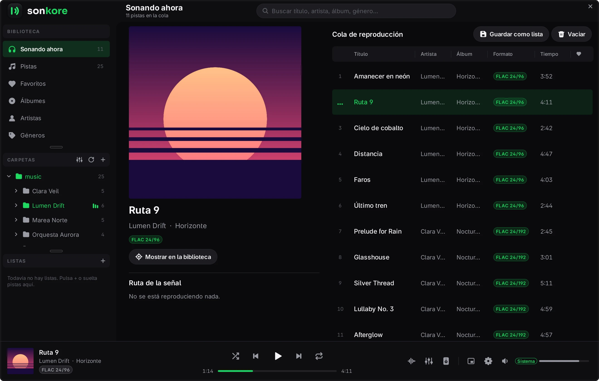
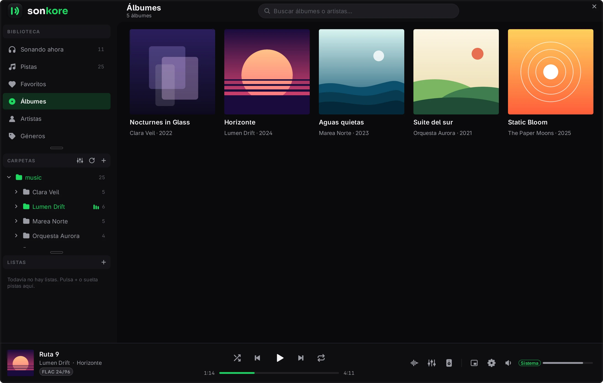
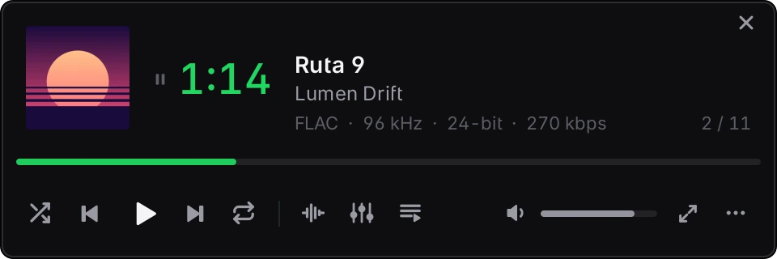

# Sonkore

**A hi-fi music player for the desktop: bit-perfect, lightweight and distraction-free.**

Linux · Windows 10/11 · Free software (GPL-3.0)

[**Download**](https://github.com/Axiokyn/Sonkore/releases/latest) &nbsp;·&nbsp; [Features](docs/features.md) &nbsp;·&nbsp; [Building](docs/building.md) &nbsp;·&nbsp; [Roadmap](ROADMAP.md) &nbsp;·&nbsp; [sonkore.org](https://sonkore.org)

 

## Why Sonkore

- **Truly bit-perfect.** Direct ALSA `hw:`, native PipeWire (follows each track's sample rate), JACK, WASAPI exclusive and ASIO. Leave volume and DSP alone and every bit of the file reaches the DAC.
- **Native DSD, DoP or conversion to PCM**, DST included, with its own double-precision converter.
- **Reference DSP.** Graphic or parametric equalizer, optionally linear-phase, with AutoEQ for about 7,000 headphones; FIR convolution, crossfeed, oversampling, true-peak limiter, noise-shaped dither, ReplayGain 2.0 and HDCD.
- **Signal path** in plain sight: every stage from the file to the DAC, with its quality.
- **Sample-exact gapless playback**, also with the equalizer or volume in use.
- **Almost every format:** FLAC, WAV, MP3, ALAC, AAC, Opus, Vorbis, AIFF, APE, WavPack, DSF/DFF, CUE and more.
- **A comfortable library:** watched folders, folder tree, 20 columns, M3U playlists, a mini player and 39 themes.

  
  &nbsp;
  

## Download

Ready to use, nothing to install. Each file has its `.sha256` next to it.

| System | File | How to use it |
|---|---|---|
| **Linux** x86_64 (glibc 2.34+: Ubuntu 22.04+, Debian 12+, Fedora, Arch, openSUSE…) | [`Sonkore-x86_64.AppImage`](https://github.com/Axiokyn/Sonkore/releases/latest/download/Sonkore-x86_64.AppImage) | `chmod +x` it and run it |
| **Linux** x86_64, Flatpak (any distribution with Flatpak) | [`Sonkore-x86_64.flatpak`](https://github.com/Axiokyn/Sonkore/releases/latest/download/Sonkore-x86_64.flatpak) | `flatpak install --user Sonkore-x86_64.flatpak` (the KDE runtime comes from Flathub) |
| **Windows** 10/11, 64-bit | [`Sonkore-windows-x64.zip`](https://github.com/Axiokyn/Sonkore/releases/latest/download/Sonkore-windows-x64.zip) | Unzip it and run `Sonkore.exe` |

On Linux, `packaging/linux/install-user.sh` adds Sonkore to the application menu.

The app speaks English, Spanish, Portuguese, French, German and Italian.

## Development

To build it, see [docs/building.md](docs/building.md).

## License

© Axiokyn. Free software under the [GNU General Public License v3.0 or later](LICENSE). Third-party components (SoundTouch, libsoxr, miniaudio, dr_libs, FFmpeg, icons based on Feather and OFL fonts) and their copyright notices are listed in [THIRD-PARTY.md](THIRD-PARTY.md).
